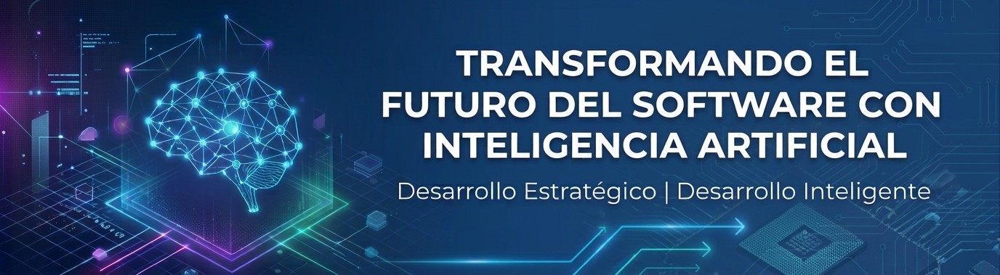

 

  

<h1 align="center">Hola 👋, soy Andres Ramos</h1>

## 👨‍💻 Sobre mí

<table>
  <tr>
    <td width="62%" valign="top">
      
Soy de Colombia y mi ciudad de origen es <strong>Pitalito, Huila</strong>, una región reconocida por su tradición cafetera y la calidad de su café.

      
Soy desarrollador de software con más de <strong>4 años de experiencia</strong>, principalmente en el desarrollo backend

      
Fuera de la tecnología, disfruto levantar pesas, escuchar música, leer e investigar sobre temas que despiertan mi curiosidad. 

    </td>
    <td width="38%" valign="top" align="center">
      <h3>🛠️ Tecnologías principales</h3>
      
      
También estoy explorando herramientas de inteligencia artificial aplicadas al desarrollo de software, como Cursor.

    </td>
  </tr>
</table>

## 🎯 ¿Qué me interesa?

<table>
  <tr>
    <td align="center" valign="top" width="25%">
      <h3>💻</h3>
      <strong>Desarrollo de software</strong>
      
Construir soluciones modulares, mantenibles y bien estructuradas, prestando atención a la calidad del código, la organización de los componentes y las decisiones técnicas que facilitan la evolución de los sistemas.

    </td>
    <td align="center" valign="top" width="25%">
      <h3>🤖</h3>
      <strong>Inteligencia artificial</strong>
      
Explorar cómo la IA puede ampliar las capacidades del software, ayudar a resolver problemas, mejorar los procesos de desarrollo y abrir nuevas posibilidades para la creación de productos.

    </td>
    <td align="center" valign="top" width="25%">
      <h3>🚀</h3>
      <strong>Desarrollo de productos</strong>
      
Participar en la evolución de ideas, desde la identificación de un problema y la comprensión de sus necesidades hasta el diseño y la construcción de soluciones útiles que aporten valor.

    </td>
    <td align="center" valign="top" width="25%">
      <h3>📚</h3>
      <strong>Aprendizaje continuo</strong>
      
Profundizar en nuevas tecnologías, investigar cómo funcionan las cosas, experimentar con diferentes herramientas y convertir el conocimiento adquirido en experiencia práctica.

    </td>
  </tr>
</table>

## 🚀 Mi camino en el desarrollo de software

A lo largo de mi trayectoria he pasado de construir e integrar componentes de software a involucrarme en diferentes etapas del ciclo de vida de los productos: desde el análisis de problemas y el diseño de soluciones hasta la implementación, la arquitectura, el despliegue y la coordinación del trabajo técnico.

## 💼 Experiencia profesional

<table>
  <tr>
    <td width="50%" valign="top">
  <h3>🏢 R5</h3>
  
<strong>Fintech · Área de seguros</strong>

  
Durante mis primeros años trabajé en el área de seguros de R5, donde participé en el desarrollo de automatizaciones, scripts e integraciones. También brindé soporte técnico interno y externo a diferentes áreas y entidades, entre ellas <strong>Bancolombia y AXA Seguros</strong>, apoyando la operación de venta de SOAT desde la plataforma.

  
<strong>Responsabilidades y proyectos</strong>

  <ul>
    <li><strong>Soporte técnico interno y externo:</strong> atención de requerimientos, análisis de errores y resolución de incidentes relacionados con la operación.</li>
    <li><strong>Venta de SOAT:</strong> soporte al funcionamiento de los procesos de venta desde el sistema de R5.</li>
    <li><strong>Integraciones con terceros:</strong> desarrollo y mantenimiento de conexiones con entidades financieras, aseguradoras y otros proveedores.</li>
    <li><strong>Integración de servicios:</strong> incorporación de nuevas aseguradoras y pasarelas de pago.</li>
    <li><strong>Automatización de procesos:</strong> desarrollo de scripts y herramientas para optimizar tareas operativas.</li>
    <li><strong>Prevención de fraude:</strong> participación en herramientas para la gestión de fraudes y listas de clientes restringidos.</li>
  </ul>

  
<a href="https://www.grupor5.com/comprar-soat-en-linea">Conocer R5 ↗</a>

<td width="50%" valign="top">
  <h3>🚀 Novadynamics</h3>
  
<strong>Desarrollo de productos de software</strong>

  
Actualmente trabajo en Novadynamics, participando en el desarrollo de una solución tecnológica para <em>contact centers virtuales</em>. La plataforma integra chat, telefonía, herramientas de gestión e inteligencia artificial para centralizar la operación en un mismo entorno.

  
<strong>Áreas de trabajo</strong>

  <ul>
    <li><strong>Análisis de requerimientos:</strong> identificación de necesidades y definición de soluciones técnicas.</li>
    <li><strong>Bases de datos:</strong> diseño, estructuración y gestión de modelos de datos.</li>
    <li><strong>Desarrollo de software:</strong> implementación y evolución de funcionalidades de la plataforma.</li>
    <li><strong>Inteligencia artificial:</strong> desarrollo e implementación de capacidades de IA dentro de las soluciones de software.</li>
    <li><strong>Arquitectura:</strong> participación en decisiones técnicas sobre el diseño y la organización de las soluciones.</li>
    <li><strong>Despliegue:</strong> puesta en funcionamiento de aplicaciones y nuevas funcionalidades.</li>
    <li><strong>Herramientas y procesos:</strong> desarrollo de utilidades internas y optimización de los procesos de trabajo del equipo.</li>
  </ul>

  
<a href="https://nova-dynamics.net/">Visitar Novadynamics ↗</a>

</td>
  </tr>
</table>

## 🧰 Tech Stack

  <em>Tecnologías y herramientas que me interesa aprender, explorar y seguir incorporando a mi desarrollo profesional.</em>

### 💻 Languages

  
  
  
  
  

### ⚙️ Backend & APIs

  
  
  
  

### 🌐 Frontend

  
  
  
  

### 🗄️ Databases

  
  
  

### ☁️ Cloud & DevOps

  
  
  
  
  

### ☁️ AWS Services

  
  
  
  
  
  
  
  

### 🛠️ Development Tools

  
  
  
  
  

### 🤖 Areas of Interest

  
  
  
  
  
  
  

